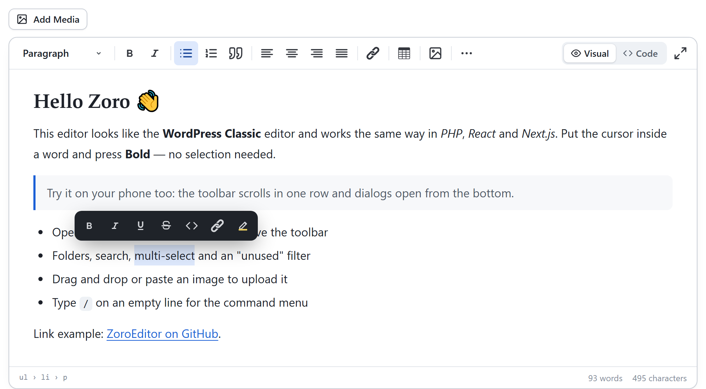
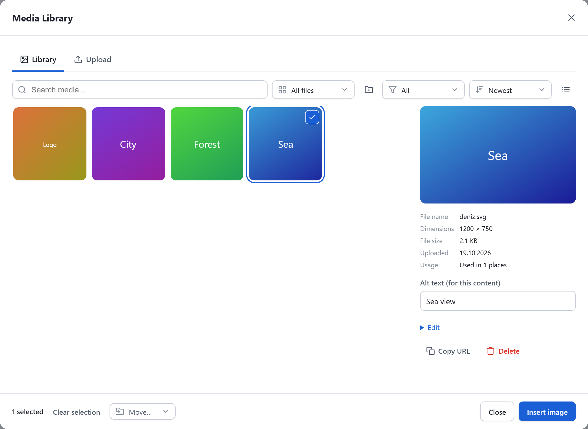
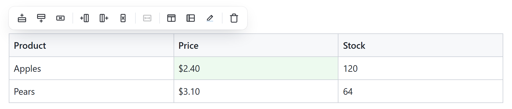
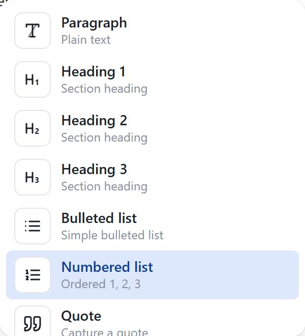
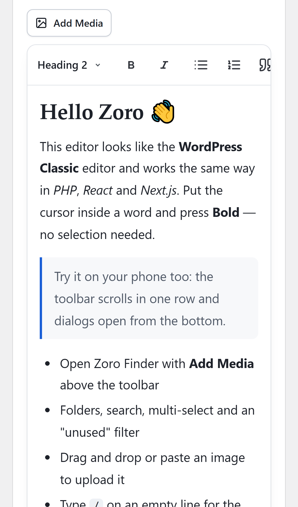
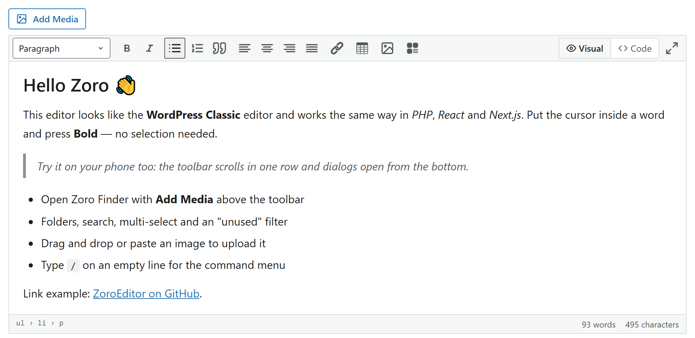

# ZoroEditor

[](https://www.npmjs.com/package/zoro-editor)
[](https://github.com/selzerey/zoro-editor/actions/workflows/ci.yml)
[](LICENSE)
[](#browser-support-and-bundle-size)

A WordPress Classic–style rich text editor that works the same way in **plain PHP, React, Next.js and TypeScript** — with a built-in, CKFinder-like media manager (**Zoro Finder**) and a ready-to-use **PHP media backend**.



- **MIT licensed.** No license key, no "Powered by" badge, no cloud account. Built on [TipTap v3](https://tiptap.dev) / ProseMirror.
- **One `<script>` tag** in a PHP page, or **`npm install`** in React / Next.js. Nothing is loaded from third-party CDNs at runtime.
- **Two skins:** `modern` (TinyMCE-Premium-like, default) and `classic` (WordPress Classic Editor look).
- **Toolbar groups & presets:** turn whole groups on or off with one line (`minimal`, `basic`, `blog`, `full`, or your own).
- **Mobile first:** one-row scrolling toolbar, 40px touch targets, bottom-sheet dialogs, touch image resizing.
- **Clean, SEO-friendly HTML:** `srcset`, `width`/`height`, `loading="lazy"`, `alt`, WordPress `align*` classes, `<figure>` captions, optional `nofollow` / `sponsored`.
- **Paste that just works:** Word lists become real lists, Google Docs formatting is kept, Excel tables paste as tables (not as a screenshot), pasted or dropped images are uploaded (never embedded as base64).
- **Secure by default:** server-side HTML sanitizer (`Sanitizer::clean`) using the browser-grade HTML5 parser on PHP 8.4+, and a media API that refuses to run without an `auth` callback.

**Try it now:** download the repo and open [`test/ZoroEditor-Demo.html`](test/ZoroEditor-Demo.html) in your browser — a single self-contained file, no server or internet needed.

| Zoro Finder (media manager) | Table toolbar & `/` commands | Mobile |
|---|---|---|
|  |   |  |

---

## Contents

- [Features](#features)
- [Quick start (PHP site, 5 minutes)](#quick-start-php-site-5-minutes)
- [Installation](#installation)
- [Usage](#usage)
  - [Plain PHP / HTML](#plain-php--html)
  - [JavaScript (no framework)](#javascript-no-framework)
  - [React](#react)
  - [Next.js (App Router)](#nextjs-app-router)
  - [Laravel / Blade, Symfony / Twig and others](#laravel--blade-symfony--twig-and-others)
- [Toolbar groups and presets](#toolbar-groups-and-presets)
- [Zoro Finder (media manager)](#zoro-finder-media-manager)
- [PHP media backend](#php-media-backend)
- [Options](#options)
- [API](#api)
- [Keyboard shortcuts](#keyboard-shortcuts)
- [Theming](#theming)
- [Languages](#languages)
- [Security](#security)
- [Browser support and bundle size](#browser-support-and-bundle-size)
- [Troubleshooting](#troubleshooting)
- [Development](#development)
- [License](#license)

---

## Features

**Editing**
- Paragraph, headings 1–6, preformatted/code block, bold, italic, underline, strikethrough, inline code, superscript, subscript
- Bulleted and numbered lists, indent/outdent, blockquote, horizontal rule, special characters
- Text color and highlight (palette, recent colors, custom HEX)
- Alignment (left, center, right, justify)
- Links with a quick inline popover (Ctrl+K) and an advanced dialog: title, new tab, `nofollow`, `sponsored`; `javascript:` and other unsafe URLs are rejected
- Tables with a size picker and a contextual toolbar: insert/delete rows and columns, merge/split cells, header row/column, cell background
- Images: resize by dragging (mouse and touch), WordPress-style left/right alignment that wraps text, center, captions (`<figure>`/`<figcaption>`), decorative images (`alt=""` + `role="presentation"`)
- YouTube embeds (privacy-friendly `youtube-nocookie.com`)
- **Bubble menu** on text selection and a **`/` command menu** (modern skin) with accent-insensitive search (`/heading`, `/table`, `/image`…)
- Visual / Code (HTML source) toggle with auto-indented HTML; the cursor stays on the same block when switching
- Fullscreen, word/character count, element path (`ul › li › p`), optional character limit
- Draft autosave in the browser with a "restore" prompt
- WordPress keyboard shortcuts (Shift+Alt+1…7, Ctrl+K, …), Alt+F10 to reach the toolbar, full keyboard navigation

**Pasting**
- Microsoft Word: `mso-list` paragraphs become nested `<ul>`/`<ol>` (with start numbers), title/heading styles become `<h1>`–`<h6>`, Word junk is removed, local `file:///` images are dropped with a notice
- Google Docs: the "everything is bold" wrapper is removed, styled spans become `<strong>`, `<em>`, `<u>`, `<s>`, `<sup>`, `<sub>`, colors and highlights are kept
- Excel / Google Sheets: tables paste as tables
- Smart paste: a URL pasted over selected text becomes a link; a YouTube or image URL pasted on an empty line becomes an embed / image

**Media**
- Zoro Finder: library, upload, folders, search, sort, grid/list view, multi-select, bulk delete/move, details panel, copy URL, "unused files" filter, keyboard navigation
- Paste or drop images into the editor → upload with a progress ring; failed uploads show **Retry / Remove** instead of disappearing
- PHP backend: no database, WebP variants (`thumb`, `sm`, `md`, `lg`, `xl`), EXIF orientation fix, SHA-256 duplicate detection, optional on-the-fly resizing with an allow-list

**Integration**
- Vanilla JS class, auto-init from `data-*` attributes, PHP helper `Editor::render()`
- React component (controlled and uncontrolled, StrictMode-safe, form/Server Action friendly) and `useZoroFinder()` hook
- Next.js: works in the App Router with SSR, no `dynamic(..., { ssr: false })` needed
- TypeScript types included
- Light, dark and automatic (system) themes; CSS variables for colors and fonts

---

## Quick start (PHP site, 5 minutes)

**1. Download.** On GitHub click **Code → Download ZIP** (or `git clone https://github.com/selzerey/zoro-editor.git`).

**2. Copy.** Put the folder in your site's root as `zoro`. Only these two folders are needed on the server:

```
public_html/
└── zoro/
    ├── dist/      ← the editor (already built)
    └── php/       ← media API + HTML sanitizer
```

**3. Configure media.** Copy `zoro/php/config.example.php` to `zoro/php/config.php` and fill in `auth` with your own login check (who may upload and delete files):

```php
'auth' => function (string $action): bool {
    if (session_status() !== PHP_SESSION_ACTIVE) session_start();
    return !empty($_SESSION['admin_id']);   // your admin login check
},
```

By default files are written to `/uploads` in your site root (`upload.path` / `upload.url_base` in the same file).

**4. Add the editor to your form.** Add `data-zoro-editor` to a `<textarea>` and include the script once:

```html
<form method="post" action="save.php">
  <textarea name="content" data-zoro-editor data-preset="blog"
            data-media-endpoint="/zoro/php/public/media.php"><?= htmlspecialchars($post['content'] ?? '') ?></textarea>
  <button>Save</button>
</form>

<script src="/zoro/dist/zoro-editor.iife.js" defer></script>
```

The editor replaces the textarea and keeps its value in sync, so the form submits normally.

**5. Sanitize when saving** (required — never trust HTML coming from the browser):

```php
require __DIR__ . '/zoro/php/autoload.php';

$clean = \Zoro\Editor\Sanitizer::clean($_POST['content']);
$pdo->prepare('UPDATE posts SET content = ? WHERE id = ?')->execute([$clean, $id]);
```

**6. Show the content.** Add the small front-end stylesheet (image alignment, captions, tables, videos):

```html
<link rel="stylesheet" href="/zoro/dist/zoro-content.css">
<article class="zoro-output"><?= $post['content'] ?></article>
```

That's it. Everything below is optional detail.

---

## Installation

ZoroEditor is published on [npm](https://www.npmjs.com/package/zoro-editor) and GitHub. The `dist/` folder is prebuilt, so no build step is needed.

### Download (plain PHP / HTML)

Download the ZIP from GitHub and copy `dist/` (and `php/` if you want the media backend). See the [quick start](#quick-start-php-site-5-minutes).

### CDN

```html
<script src="https://cdn.jsdelivr.net/npm/zoro-editor@1/dist/zoro-editor.iife.js"></script>
<link rel="stylesheet" href="https://cdn.jsdelivr.net/npm/zoro-editor@1/dist/zoro-content.css">
```

Also available on unpkg (`https://unpkg.com/zoro-editor@1`) and straight from GitHub (`https://cdn.jsdelivr.net/gh/selzerey/zoro-editor@v1.0.1/dist/zoro-editor.iife.js`). The IIFE build injects its own CSS. Pin an exact version (e.g. `@1.0.1`) in production, or self-host the files.

### npm (React, Next.js, Vite, any bundler)

```bash
npm install zoro-editor
# pnpm add zoro-editor  ·  yarn add zoro-editor  ·  bun add zoro-editor
```

```js
import { ZoroEditor } from 'zoro-editor';          // vanilla class
import { ZoroEditor } from 'zoro-editor/react';    // React component
import 'zoro-editor/style.css';                    // editor styles
import 'zoro-editor/content.css';                  // front-end styles (optional)
```

Package entry points:

| Import | What |
|---|---|
| `zoro-editor` | Core class, Finder, adapters, helpers, TypeScript types (ESM) |
| `zoro-editor/react` | `<ZoroEditor />`, `useZoroFinder()` (marked `"use client"`) |
| `zoro-editor/style.css` | Editor + Finder styles |
| `zoro-editor/content.css` | Styles for displaying saved content |
| `dist/zoro-editor.iife.js` | Single file for `<script>` tags, exposes `window.ZoroEditor`, includes CSS |

React 18 and 19 are supported (optional peer dependency).

### Composer (PHP backend and sanitizer only)

```bash
composer config repositories.zoro vcs https://github.com/selzerey/zoro-editor
composer require zoro/editor:^1.0
```

Classes are autoloaded under `Zoro\Editor\`. Without Composer use `require 'zoro/php/autoload.php';`.

Requirements: **PHP 8.1+** with `dom`, `fileinfo`, `mbstring`, `json`; `gd` (with WebP) for image variants; `exif` to fix phone photo orientation.

---

## Usage

### Plain PHP / HTML

**With `data-*` attributes** (auto-initialised when the page loads):

```html
<textarea name="content"
          data-zoro-editor
          data-preset="blog"
          data-add-groups="embed"
          data-media-endpoint="/zoro/php/public/media.php"
          data-height="450"
          data-skin="modern"
          data-theme="auto"
          data-autosave="post-42"></textarea>
<script src="/zoro/dist/zoro-editor.iife.js" defer></script>
```

Supported attributes: `data-preset`, `data-groups`, `data-add-groups`, `data-remove-groups` (comma-separated), `data-height`, `data-placeholder`, `data-skin` (`modern|classic`), `data-theme` (`light|dark|auto`), `data-locale` (`en|tr`), `data-max-length`, `data-autosave`, `data-readonly`, `data-media-endpoint`, `data-media="false"`, `data-csrf-token`, `data-bubble-menu="false"`, `data-options` (JSON for everything else).

A CSRF token is read automatically from `<meta name="csrf-token" content="…">` or `data-csrf-token` and sent as the `X-CSRF-Token` header.

**With the PHP helper:**

```php
require 'zoro/php/autoload.php';
use Zoro\Editor\Editor;

Editor::$scriptUrl = '/zoro/dist/zoro-editor.iife.js';

echo Editor::render('content', $post['content'] ?? '', [
    'preset'    => 'blog',
    'addGroups' => ['embed'],
    'media'     => '/zoro/php/public/media.php',
    'height'    => 450,
    'skin'      => 'classic',
]);
```

The `<script>` tag is printed only once per page, so you can render several editors.

To initialise editors added later (AJAX, modals): `ZoroEditor.init(containerElement)`.
Each auto-initialised element gets `element.zoroEditor` (the instance).

### JavaScript (no framework)

```html
<div id="editor"></div>
<script src="/zoro/dist/zoro-editor.iife.js"></script>
<script>
  const editor = new ZoroEditor('#editor', {
    content: '<p>Hello</p>',
    preset: 'blog',
    media: { endpoint: '/zoro/php/public/media.php' },
    onChange: (html) => console.log(html),
  });
</script>
```

With a bundler (Vite, Webpack, Vue, Svelte, Angular…):

```js
import { ZoroEditor } from 'zoro-editor';
import 'zoro-editor/style.css';

const editor = new ZoroEditor(document.querySelector('#editor'), { preset: 'basic' });
// … later, e.g. in onUnmounted / ngOnDestroy:
editor.destroy();
```

The target can be any element or a `<textarea>` (the editor replaces it and writes the HTML back into it).

### React

```tsx
import { useState } from 'react';
import { ZoroEditor } from 'zoro-editor/react';
import 'zoro-editor/style.css';

export function PostForm() {
  const [html, setHtml] = useState('<p>Hello</p>');
  return (
    <ZoroEditor
      value={html}
      onChange={setHtml}
      preset="blog"
      media={{ endpoint: '/zoro/php/public/media.php' }}
    />
  );
}
```

- Controlled (`value` + `onChange`) or uncontrolled (`defaultValue`); typing never makes the cursor jump.
- Safe under React StrictMode (the double mount leaves exactly one editor).
- `name="content"` renders a hidden input, so plain `<form>` posts and Server Actions just work.
- `readOnly` and `theme` update live; changing `preset`, `groups`, `locale`, `skin` or `media` rebuilds the editor while keeping the content. `extensions` is read once — give the component a new `key` to change it.
- Ref handle: `getHTML()`, `setContent(html, emit?)`, `insertHTML(html)`, `focus()`, `clearDraft()`, `getInstance()` (the core instance).

**Standalone Finder** (featured image, avatar, gallery):

```tsx
import { useZoroFinder } from 'zoro-editor/react';

const openFinder = useZoroFinder({ endpoint: '/zoro/php/public/media.php' });

<button onClick={() => openFinder({ onSelect: ([img]) => setCover(img.url) })}>
  Choose cover image
</button>
```

### Next.js (App Router)

`zoro-editor/react` is marked `"use client"` and creates the editor only in the browser, so it can be rendered from a Server Component page without `dynamic(…, { ssr: false })`.

```tsx
// app/layout.tsx
import 'zoro-editor/style.css';
import 'zoro-editor/content.css';
```

```tsx
// app/posts/new/page.tsx  (Server Component)
import { savePost } from './actions';
import { ZoroEditor } from 'zoro-editor/react';

export default function Page() {
  return (
    <form action={savePost}>
      <ZoroEditor name="content" defaultValue="" preset="blog" media={{ endpoint: '/api/media' }} />
      <button type="submit">Save</button>
    </form>
  );
}
```

No PHP? [`examples/nextjs/app/api/media/route.ts`](examples/nextjs/app/api/media/route.ts) implements the media API as a Next.js route handler. Sanitize the HTML on the server (for example with `sanitize-html`) before storing it.

Note: the Next.js 16 dev server blocks requests from `127.0.0.1` by default — open `http://localhost:3000` or set `allowedDevOrigins`.

### Laravel / Blade, Symfony / Twig and others

Any server-rendered stack works with the textarea approach:

```blade
<meta name="csrf-token" content="{{ csrf_token() }}">

<textarea name="content" data-zoro-editor data-preset="blog"
          data-media-endpoint="{{ url('/zoro/php/public/media.php') }}">{{ old('content', $post->content) }}</textarea>

<script src="{{ asset('zoro/dist/zoro-editor.iife.js') }}" defer></script>
```

```php
// Controller
$post->content = \Zoro\Editor\Sanitizer::clean($request->input('content'));
```

You can also point `data-media-endpoint` at your own controller that implements the [media API contract](docs/media-api.md), so files go through your existing storage (S3, database records, …).

---

## Toolbar groups and presets

The toolbar is built from groups. Row 2 opens with the "⋯" button (modern) or the toolbar toggle (classic), like in WordPress (Shift+Alt+Z).

| Group | Buttons | Row |
|---|---|---|
| `block` | Paragraph / Heading 1–6 / Preformatted | 1 |
| `format` | Bold, italic · underline, strikethrough, inline code, superscript, subscript | 1 · 2 |
| `list` | Bulleted list, numbered list, blockquote | 1 |
| `align` | Left, center, right, justify | 1 |
| `link` | Insert link · remove link | 1 · 2 |
| `table` | Table size picker / table actions | 1 |
| `media` | Image button + the **Add Media** button above the toolbar | 1 |
| `embed` | YouTube video | 2 |
| `color` | Text color, background color | 2 |
| `extra` | Horizontal line, clear formatting, special characters | 2 |
| `indent` | Outdent, indent | 2 |
| `history` | Undo, redo | 2 |
| `help` | Keyboard shortcuts | 2 |
| `view` | Visual / Code toggle, fullscreen | 1 |

| Preset | Groups |
|---|---|
| `minimal` | format, link, list |
| `basic` | block, format, list, link, history, view |
| `blog` | block, format, list, align, link, table, media, color, extra, indent, history, help, view |
| `full` (default) | all groups |

```js
new ZoroEditor('#e', { preset: 'blog', addGroups: ['embed'], removeGroups: ['color'] });
new ZoroEditor('#e', { groups: ['format', 'link'] });   // exactly these

editor.addGroups(['table', 'color']);   // at runtime
editor.removeGroups(['table']);
editor.setPreset('minimal');
```

The `media` group only appears when media is configured (`media.endpoint`, `media.adapter` or `onImageUpload`). The `/` menu and the bubble menu only show commands whose group is enabled.

### Custom groups

```js
ZoroEditor.registerGroup({
  name: 'signature',
  row: 1,
  items: [{
    name: 'signature',
    icon: '<svg viewBox="0 0 24 24" width="20" height="20"><path d="M4 18h16" stroke="currentColor" fill="none"/></svg>',
    title: 'Insert signature (Ctrl+Shift+S)',   // the part in parentheses is shown as a shortcut in the tooltip
    run: ({ editor }) => editor.chain().focus().insertContent('<p><em>— The Zoro team</em></p>').run(),
    isActive: ({ editor }) => false,
  }],
});
ZoroEditor.registerPreset('news', ['block', 'format', 'link', 'media', 'signature']);

new ZoroEditor('#e', { preset: 'news' });
```

`run` and `isActive` receive `{ editor, zoro, t }`: the TipTap editor, the ZoroEditor instance and the current translations. Extra TipTap extensions can be passed with the `extensions` option or a group's `extensions` field.

---

## Zoro Finder (media manager)

**Add Media** (Shift+Alt+M) opens Zoro Finder. It can also be used without an editor (`ZoroEditor.openFinder` in the `<script>` build, `import { openFinder } from 'zoro-editor'` with a bundler):

```js
ZoroEditor.openFinder({
  endpoint: '/zoro/php/public/media.php',
  multiple: false,
  title: 'Featured image',
  selectLabel: 'Use this image',
  onSelect: ([image]) => {
    document.querySelector('#cover').value = image.url;   // image.insertAlt = alt text typed by the user
  },
});
```

What it does:

- Grid / list view, search, sort (newest, oldest, name, size), loads more files as you scroll
- Virtual folders: moving a file never changes its URL, so links in existing content keep working
- Multi-select (Ctrl/Shift+click), bulk delete and move
- Details panel: preview, dimensions, size, date, usage count, edit alt text / caption / file name, copy URL, delete
- "Unused" filter when the backend reports usage counts
- Upload tab: drag & drop, paste from clipboard, progress bars, alt text suggested from the file name, alt text required by default
- Keyboard: arrow keys, Enter to select, Delete to delete, double-click to insert
- On phones the details panel opens below the grid and the action buttons stay visible

### Connect your own backend

Finder talks to any backend through a small adapter. Two options:

1. Implement the same JSON endpoint as the PHP backend — see [docs/media-api.md](docs/media-api.md).
2. Write a `MediaAdapter`:

```ts
import type { MediaAdapter } from 'zoro-editor';

const adapter: MediaAdapter = {
  async list({ page, limit, search, folder }) {
    const r = await fetch(`/api/images?page=${page}&q=${search ?? ''}`).then((r) => r.json());
    return { items: r.data.map((x) => ({ id: x.id, url: x.path, filename: x.name, alt: x.alt })), total: r.total, hasMore: r.next };
  },
  async upload(file, { alt, folder, onProgress }) {
    // … upload the file, call onProgress(0-100) …
    return { id: 1, url: '/u/a.jpg', filename: 'a.jpg', alt };
  },
  // Optional — when missing, the related buttons are hidden:
  // update(id, { alt, caption, title, filename }), remove(ids), move(ids, folder), createFolder(path), deleteFolder(path)
};

new ZoroEditor('#e', { media: { adapter } });
```

Only need simple uploads (no library)? Use `onImageUpload`:

```js
new ZoroEditor('#e', {
  onImageUpload: async (file) => {
    const body = new FormData();
    body.append('file', file);
    const r = await fetch('/upload.php', { method: 'POST', body }).then((r) => r.json());
    return r.url;   // or { url, alt }
  },
});
```

`MemoryMediaAdapter` (in-browser, for demos and tests) and `RestMediaAdapter` (the PHP contract) are exported too.

---

## PHP media backend

No database: metadata lives in `uploads/.zoro/media.json`, written under a file lock.

**Setup:** copy `php/config.example.php` to `php/config.php`, write the `auth` callback, and point the editor to `php/public/media.php`. Without `auth` the API answers **403** on purpose.

What it does:

- Detects the file type from its content (never trusts the extension or the browser), re-encodes images (removes hidden payloads and EXIF/GPS data), fixes EXIF orientation
- Downscales huge images to `upload.max_width` (default 2560 px); optional JPEG/PNG → WebP conversion
- Generates WebP variants: `thumb` 150×150, `sm` 480, `md` 768, `lg` 1200, `xl` 1920 — the editor inserts them as `srcset`
- SHA-256 duplicate detection (uploading the same file again returns the existing item)
- Writes an `.htaccess` that disables script execution in the upload folder and denies access to the metadata folder
- Rename (variants included) with an `on_rename($oldUrl, $newUrl, $item)` hook to update URLs in your content
- `usage_counter($item)` hook for the "unused" filter and "used in N places"
- `on_delete($item)` hook to veto deletions
- Optional CORS allow-list and CSRF check (`csrf($token)`, token from the `X-CSRF-Token` header)
- All mutating actions use `POST` (works on shared hosts that block `PATCH`/`DELETE`)
- If `upload.path` points to an upload folder of the original ZoroEditor, its `media.json` library is imported automatically

```php
// php/config.php
return [
    'upload' => [
        'path'            => dirname(__DIR__, 2) . '/uploads',
        'url_base'        => '/uploads',
        'max_size'        => 20 * 1024 * 1024,
        'allowed'         => ['image/jpeg', 'image/png', 'image/gif', 'image/webp', 'image/avif'],
        'convert_to_webp' => false,
        'max_width'       => 2560,
    ],
    'auth'  => fn (string $action) => !empty($_SESSION['admin_id']),
    'csrf'  => fn (?string $token) => hash_equals($_SESSION['csrf'] ?? '', (string) $token),
    'cors'  => ['https://admin.example.com'],
    'usage_counter' => fn (array $item) => countPostsUsing($item['url']),
    'on_rename'     => fn (string $old, string $new) => replaceInPosts($old, $new),
];
```

### On-the-fly image resizing (optional)

```apache
# .htaccess
RewriteRule ^img/(.*)$ zoro/php/public/image.php?p=$1 [L,QSA]
```

```nginx
location /img/ { rewrite ^/img/(.*)$ /zoro/php/public/image.php?p=$1 last; }
```

`/img/w640-q75/2026/10/photo.jpg` returns a 640 px wide AVIF/WebP/JPEG (based on the `Accept` header), cached on disk. Only the widths and qualities listed in `image_cache.widths` / `image_cache.qualities` are allowed; other values are rounded up to the next allowed one, so nobody can fill your disk with endless variants.

---

## Options

| Option | Type | Default | Description |
|---|---|---|---|
| `content` | `string` | `''` | Initial HTML (a textarea target uses its value) |
| `preset` | `string` | `'full'` | Toolbar preset |
| `groups` | `string[]` | — | Exact list of groups (replaces the preset) |
| `addGroups` / `removeGroups` | `string[]` | — | Add to / remove from the preset |
| `skin` | `'modern' \| 'classic'` | `'modern'` | Modern (TinyMCE-Premium-like) or WordPress Classic look |
| `theme` | `'light' \| 'dark' \| 'auto'` | `'light'` | `auto` follows the operating system |
| `locale` | `'en' \| 'tr' \| object` | from `<html lang>` | UI language or your own strings |
| `height` | `number` | `400` | Minimum height in px |
| `autoGrow` | `boolean` | `true` | Grow with the content (`false` = fixed height with an inner scroll) |
| `placeholder` | `string` | localized | Empty editor hint |
| `readOnly` | `boolean` | `false` | |
| `maxLength` | `number` | — | Character limit |
| `media` | `MediaOptions \| false` | — | See below |
| `onImageUpload` | `(file) => Promise<string \| { url, alt }>` | — | Simple upload hook (no Finder) |
| `bubbleMenu` | `boolean` | on in modern | Formatting menu above selected text |
| `slashMenu` | `boolean` | on in modern | `/` command menu |
| `stickyToolbar` | `boolean \| number` | `true` | Keep the toolbar visible while scrolling; a number = top offset (e.g. your fixed header height) |
| `input` | `string \| Element` | — | Also write the HTML into this input/textarea |
| `statusBar` | `boolean` | `true` | Element path and word/character count |
| `sourceMode` | `boolean` | `true` | Visual / Code toggle |
| `autosave` | `string \| { key, delay }` | — | Save drafts in `localStorage` and offer to restore them |
| `extensions` | `AnyExtension[]` | — | Extra TipTap extensions |
| `className` | `string` | — | Extra class on the wrapper |
| `onChange`, `onReady`, `onFocus`, `onBlur` | functions | — | Callbacks |

`MediaOptions`: `endpoint` (URL of the media API), `headers` (object or function, e.g. auth headers), `credentials` (`'include'` for cross-origin cookies), `transform` (map your backend's item shape), `adapter` (custom backend), `accept` (MIME types, default: images), `maxSizeMB` (default 20), `requireAlt` (default `true`), `insertVariant` (default `'lg'`), `folders` (default `true`).

---

## API

```ts
const editor = new ZoroEditor(target, options);

editor.getHTML()                    // clean HTML ('' when empty)
editor.getText()
editor.isEmpty()
editor.setContent(html, emit?)      // emit = also fire onChange
editor.insertHTML(html)
editor.insertImage({ src, alt, srcset? })
editor.focus()
editor.setReadOnly(true)
editor.setTheme('dark')             // 'light' | 'dark' | 'auto'
editor.setSkin('classic')           // 'modern' | 'classic'
editor.setMode('code')              // 'visual' | 'code'
editor.toggleFullscreen()
editor.addGroups([...]); editor.removeGroups([...]); editor.setPreset(name); editor.setGroups([...]); editor.getGroups()
editor.openMedia()                  // open Finder
editor.clearDraft()                 // call after a successful save when using autosave
editor.on('change', (html) => {})   // 'change' | 'focus' | 'blur' | 'ready' | 'mode' | 'destroy' — returns an unsubscribe function
editor.destroy()
editor.editor                       // the underlying TipTap Editor (advanced)

// Static
ZoroEditor.registerGroup(group)
ZoroEditor.registerPreset(name, groups)

// <script> (IIFE) build: everything is also available on window.ZoroEditor
ZoroEditor.openFinder(options)      // ESM: import { openFinder } from 'zoro-editor'
ZoroEditor.init(root?)              // initialise [data-zoro-editor] elements
```

Other exports from `zoro-editor`: `ZoroFinder`, `openFinder`, `RestMediaAdapter`, `MemoryMediaAdapter`, `cleanPasted`, `cleanHTML`, `isSafeUrl`, `PRESETS`, `BUILTIN_GROUPS`, `ICONS`, `locales`, and all TypeScript types (`ZoroEditorOptions`, `MediaAdapter`, `MediaItem`, `ToolbarGroup`, …).

---

## Keyboard shortcuts

| Keys | Action |
|---|---|
| Ctrl+B / I / U | Bold / italic / underline |
| Ctrl+K | Insert or edit link |
| Ctrl+Z / Ctrl+Y | Undo / redo |
| Shift+Alt+1…6 | Heading 1–6 |
| Shift+Alt+7 | Paragraph |
| Shift+Alt+Q / D / X | Blockquote / strikethrough / code block |
| Shift+Alt+L / C / R / J | Align left / center / right / justify |
| Shift+Alt+U / O | Bulleted / numbered list |
| Shift+Alt+S | Remove link |
| Shift+Alt+M | Add media |
| Shift+Alt+Z | Toggle the second toolbar row |
| Shift+Alt+H | Show all shortcuts |
| Alt+F10 | Move focus to the toolbar (arrow keys to move, Esc to return) |
| `/` | Command menu (modern skin) |
| `* `, `- `, `1. `, `> `, `## `, `---` | Markdown-style shortcuts at the start of a line |

Shortcuts use physical keys, so they work on any keyboard layout, and they only affect the focused editor (several editors on one page are fine). On macOS, Ctrl is ⌘.

---

## Theming

Everything is scoped under `.zoro-root`; the editor does not leak styles into your site. Override CSS variables to match your brand:

```css
.zoro-root {
  --zoro-primary: #e11d48;
  --zoro-primary-hover: #be123c;
  --zoro-radius: 6px;
  --zoro-font: "Inter", system-ui, sans-serif;           /* UI font */
  --zoro-content-font: Georgia, serif;                    /* text inside the editor */
  --zoro-content-heading: "Playfair Display", serif;     /* headings (modern skin) */
}
```

Other variables: `--zoro-bg`, `--zoro-surface`, `--zoro-editor-bg`, `--zoro-border`, `--zoro-border-strong`, `--zoro-text`, `--zoro-text-muted`, `--zoro-hover`, `--zoro-active-bg`, `--zoro-active-fg`, `--zoro-danger`, `--zoro-btn-size`, `--zoro-sticky-top`.

Dark mode: `theme: 'dark'`, or `theme: 'auto'` to follow `prefers-color-scheme`. Animations respect `prefers-reduced-motion`.



---

## Languages

English (`en`) and Turkish (`tr`) are built in. By default the language follows the page (`<html lang="tr">` → Turkish, anything else → English). Force one with `locale: 'en'`, or pass your own strings — missing keys fall back to the built-in text:

```js
new ZoroEditor('#e', { locale: { addMedia: 'Medien hinzufügen', bold: 'Fett (Ctrl+B)' /* … */ } });
```

See [`src/i18n.ts`](src/i18n.ts) for all keys.

---

## Security

- **Always sanitize on the server** with `Sanitizer::clean()` (PHP) or a library such as `sanitize-html` (Node). Client-side checks (blocking `javascript:` links, cleaning pasted HTML) improve the editing experience but can be bypassed.
- The PHP sanitizer is allow-list based (tags, attributes, CSS properties, URL schemes, YouTube/Vimeo iframes only), forces `rel="noopener noreferrer"` on `target="_blank"` links, and uses PHP 8.4's HTML5 parser (`Dom\HTMLDocument`) to avoid mutation-XSS; older PHP versions use libxml.
- The media API refuses to run without `auth`; use `csrf` for cookie-based sessions.
- Upload folders get an `.htaccess` that disables PHP. On **Nginx** add:

  ```nginx
  location ~* ^/uploads/.*\.(php\d?|phtml|phar)$ { deny all; }
  location ~ /\.zoro { deny all; }
  ```

- SVG uploads are off by default (SVG files can contain scripts).
- Please report security issues privately — see [SECURITY.md](SECURITY.md).

---

## Browser support and bundle size

Evergreen browsers: Chrome / Edge 111+, Firefox 113+, Safari 16.4+ (iOS and macOS), Samsung Internet 22+. The editor uses CSS container queries, `color-mix()` and `dvh` units.

| File | Size (gzip) |
|---|---|
| `dist/zoro-editor.iife.js` (everything, including TipTap, ProseMirror and CSS) | ~195 KB |
| `dist/zoro-editor.css` | ~13 KB |
| ESM build (TipTap is a dependency, deduplicated by your bundler) | ~50 KB of own code |

---

## Troubleshooting

| Symptom | Fix |
|---|---|
| Add Media opens but says **"not authorised" / 403** | The `auth` callback in `php/config.php` returns `false` — check your session / login check |
| **"config.php not found"** | Copy `php/config.example.php` to `php/config.php` |
| Large files fail to upload | Increase `upload_max_filesize` and `post_max_size` in `php.ini` |
| Images upload but **don't show** | `upload.url_base` must be the public URL of `upload.path` |
| PHP runs inside the upload folder on Nginx | Add the Nginx rules from [Security](#security) |
| The editor doesn't appear | Check the browser console for a 404 on `zoro-editor.iife.js` and fix the `src` path |
| Next.js dev: the editor doesn't load | Use `http://localhost:…` (Next.js blocks `127.0.0.1` dev requests by default) |
| The UI is in the wrong language | Set `<html lang="…">` or pass `locale: 'en'` / `'tr'` |

The PHP backend's error messages are currently in Turkish; they are shown to editors in Finder.

---

## Development

```bash
npm install
npm run build          # dist/ + test/ZoroEditor-Demo.html
npm test               # unit tests (Vitest): editor, Finder, paste, slash menu, React, SSR
npm run typecheck
npm run test:php       # PHP tests: sanitizer (incl. mutation-XSS vectors), media store, helpers

# Browser tests (desktop, iPhone, Android, real PHP upload, scrollbar audit)
php -S 127.0.0.1:8765 -t .
npm run test:e2e
```

Then open:

- `http://127.0.0.1:8765/demo/` — all features with an in-browser media library
- `http://127.0.0.1:8765/examples/php/` — real PHP backend, sanitizer and form submit

Project structure:

```
src/          TypeScript source (core, finder, ui, react, extensions, styles)
dist/         Built files (committed)
php/          PHP backend: Api, MediaStore, ImageProcessor, ImageServer, Sanitizer, Editor helper
demo/         Demo page source (uses dist/)
test/         ZoroEditor-Demo.html — single-file demo (generated by npm run build)
examples/     php, react-vite, nextjs
docs/         Media API contract, screenshots
tests/ e2e/   Unit and browser tests
```

Contributions are welcome — see [CONTRIBUTING.md](CONTRIBUTING.md).

---

## License

[MIT](LICENSE). ZoroEditor bundles [TipTap](https://github.com/ueberdosis/tiptap) and [ProseMirror](https://prosemirror.net) (both MIT). Many other editors were studied for ideas (TinyMCE, CKEditor, Jodit, Quill, Lexical, BlockNote, …); no code from GPL or commercially licensed projects is included.
